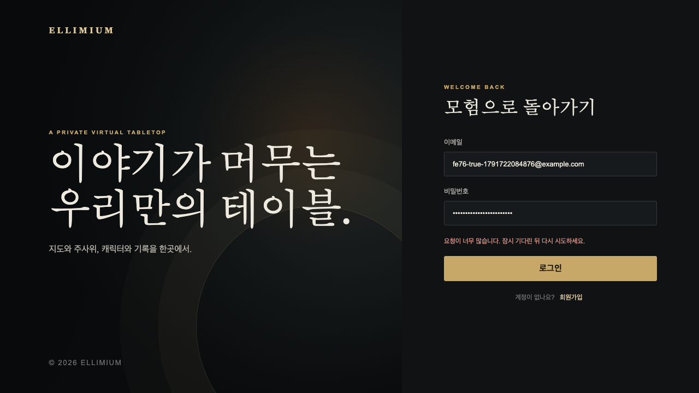

# FE #76 로그인·가입 오류 한국어 안내 검증

2026-10-11, [FE #76](https://github.com/Ellimium/Ellimium-FE/issues/76)을 `fix/76-auth-errors-ko`에서 검증했다. 최신 `origin/dev`의 `e9961d2`에서 브랜치를 생성했으며, 구현은 `1e39e85`(`Fix : 로그인 가입 오류 한국어 안내 적용`)로 커밋했다.

## 구현과 검증 환경

로그인·가입 폼이 Supabase Auth의 오류 코드와 HTTP 429, SDK의 `AuthRetryableFetchError`를 한국어 안내로 변환한다. 잘못된 자격 증명, 이메일 미확인, 요청 제한, 연결 실패를 구분하고 비밀번호 보안 조건·이메일 주소 오류에는 입력 수정 안내를 제공한다. 알 수 없는 오류와 계정 존재 여부 관련 오류는 같은 기본 안내를 표시하며 서버 오류 원문은 노출하지 않는다.

Playwright와 설치된 Chrome으로 로컬 프로덕션 FE(`http://127.0.0.1:3000`)를 검증했다. `npx supabase status -o json`으로 로컬 Supabase 실행 상태와 API 주소(`http://127.0.0.1:54321`)를 확인했다. 키 값은 출력하거나 문서에 기록하지 않았다.

로그인 폼 제출 → Supabase SDK 요청 → 실제 로컬 Auth API 또는 모의 응답 → 한국어 오류 안내 → 재시도 흐름을 확인했다. 로컬 설정은 `enable_confirmations = false`지만, 검증용 계정을 관리자 API로 이메일 미확인 상태로 생성해 실제 `email_not_confirmed` 응답을 확인했다. 테스트 계정 생성에 필요한 프로필 닉네임도 함께 지정했다.

## 자동 검증

- `npm run test:login`: 오류 분류·기본 안내·개인정보 비노출 테스트 6개 통과.
- `node --experimental-strip-types --test app/room/login-return.test.ts`: 기존 로그인 복귀 경로 테스트 4개 통과.
- `npm run build`: TypeScript 검사와 프로덕션 빌드 통과.
- `git diff --check`: 통과.

자동 검증은 구현 완료 시 수행한 결과다. 이후 제품 코드 변경 없이 브라우저 검증을 진행했다.

## Chrome 검증 결과

브라우저 스크립트의 21개 검증 항목이 통과했다. 아래 표는 중복되는 로그인·가입 시나리오를 묶었다.

| 조건 | 검증 방식 | 결과 |
|---|---|---|
| 확인된 계정의 잘못된 비밀번호 | 실제 로컬 Auth API, HTTP 400 | 이메일 또는 비밀번호 확인 안내. 폼의 `role="alert"`에 표시하고 제출 버튼이 다시 활성화됨. |
| 오류 후 올바른 비밀번호로 재시도 | 실제 로컬 Auth API | 로그인 성공 후 기본 경로(`/`)로 이동. |
| 존재하지 않는 계정 | 실제 로컬 Auth API | 잘못된 비밀번호와 동일한 안내를 표시하여 어느 자격 증명이 잘못됐는지 노출하지 않음. |
| 이메일 미확인 계정 | 실제 로컬 Auth API | 확인 이메일 링크를 연 뒤 다시 로그인하라는 안내. |
| `over_request_rate_limit`·`over_email_send_rate_limit` | 로그인·가입 Auth 응답 모의, HTTP 429 | 잠시 기다린 뒤 재시도하라는 안내. |
| 알려지지 않은 오류 코드의 HTTP 429 | 로그인·가입 Auth 응답 모의 | 오류 코드에 관계없이 요청 제한 안내. |
| 알려지지 않은 오류 | 로그인·가입 Auth 응답 모의, HTTP 400 | 안전한 기본 안내. 주입한 영어 서버 오류 원문은 표시하지 않음. |
| `email_exists` | 로그인·가입 Auth 응답 모의, HTTP 422 | 알 수 없는 오류와 같은 기본 안내. 계정 존재 여부를 별도 안내하지 않음. |
| 인증 요청 연결 실패 | 로그인·가입에서 브라우저 요청을 중단 | SDK가 반환한 연결 실패 오류를 인터넷 연결 확인·재시도 안내로 표시. |
| 오류 상태에서 재제출 | 로그인·가입 응답을 지연시켜 모의 | 이전 오류가 사라지고, 처리 중 제출 버튼이 비활성화됨. 응답 후 새 오류가 표시됨. |
| 오류 후 로그인·회원가입 모드 전환 | 로그인·가입 응답 모의 | 기존 오류 알림이 사라짐. |
| 가입 확인 이메일 안내 후 로그인 모드 전환 | 세션 없는 가입 성공 응답 모의 | 확인 이메일 안내가 사라짐. |
| 페이지 런타임 오류 | Chrome `pageerror` 수집 | 0개. |

Next.js의 페이지 알림에도 `role="alert"`가 있으므로 검증 대상은 로그인 폼 안의 오류 알림으로 한정했다. 오류 알림의 역할과 문구를 DOM에서 확인한 것이며 스크린 리더 음성 출력은 검증하지 않았다.

## 정리와 제한 사항

검증용 계정 두 개와 연관 프로필은 관리자 API로 삭제했다. 검증용 FE 서버는 종료했다. 기존 로컬 Supabase 서비스는 유지했다.

실제 요청 제한을 유발하거나 로컬 이메일 확인 설정을 변경하지 않았다. 가입 성공과 요청 제한·중복 가입·알 수 없는 오류는 응답 모의 검증이며, 연결 실패는 네트워크 자체를 끊는 대신 브라우저 요청 중단으로 재현했다. Safari·Firefox와 스크린 리더 음성 출력은 검증하지 않았다. 비밀번호 복구는 이번 범위 밖이다.

## 커밋 리뷰

2026-10-11, 구현 커밋 `1e39e85`의 전체 diff와 로그인·가입 호출부, Supabase 클라이언트 초기화, SDK의 오류 반환 처리 및 회귀 테스트를 함께 검토했다. 개인용 TRPG 플랫폼의 소수 동시 사용자를 기준으로 판단했다.

오류 코드·HTTP 상태를 통한 분류, SDK가 반환하는 연결 실패 처리, 서버 원문 및 계정 존재 여부 관련 오류의 비노출, 오류 후 재시도, 기존 로그인 복귀 경로 유지에 수정이 필요한 결함을 발견하지 못했다. 데이터 접근 권한이나 인증 성공 처리는 변경하지 않았으며 새 의존성도 추가하지 않았다.

리뷰 과정에서 오류 안내 테스트 6개와 로그인 복귀 경로 테스트 4개를 다시 실행해 모두 통과했다. 프로덕션 빌드와 Chrome 검증 결과는 위 기록을 확인했으며, 제품 코드 변경이 없어 재실행하지 않았다. Safari·Firefox와 스크린 리더 음성 출력은 검증하지 않았다.

루트 검증 기록은 Git 저장소 밖에 있으므로 같은 기록과 스크린샷을 FE 저장소의 `docs/testing`에도 보관한다. 구현 및 검증 결과를 기준으로 이번 변경은 병합 가능한 상태다.
